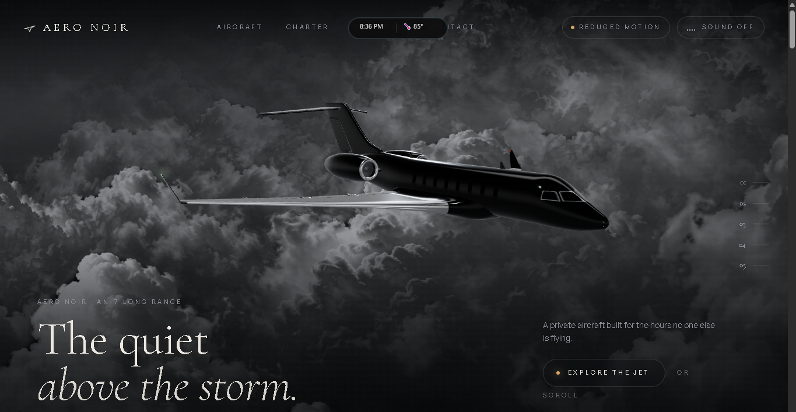
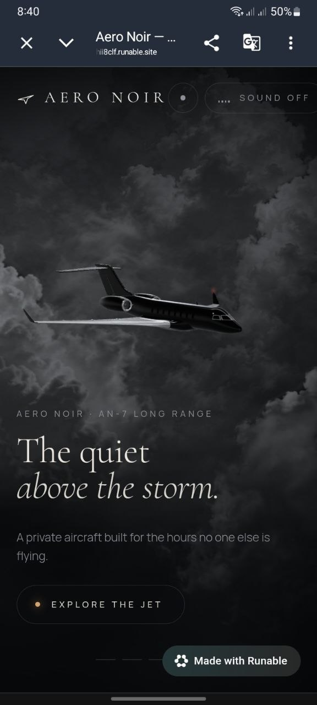

# ✈️ Air Plan Project

## 📌 Description
Air Plan Project is a modern, interactive web application built with **React** and **Vite**.  
The site replicates a sleek aviation-themed design with smooth animations, responsive layout, and immersive audio effects to enhance the user experience.  

## 🎨 Features
- ✨ Elegant UI/UX with matching color palette and typography  
- 📱 Fully responsive design for desktop and mobile  
- 🎧 Integrated sound effects for interactive elements  
- ⚡ Built with React + Vite for fast development and optimized performance  
- 🛠️ Modular components for easy customization and scalability  

## 🚀 Tech Stack
- **React** (Frontend framework)  
- **Vite** (Build tool & dev server)  
- **CSS/SCSS** (Styling and animations)  
- **JavaScript (ES6+)**  

## 📂 Project Structure
- `src/components` → Reusable React components  
- `src/assets` → Images, audio, and static files  
- `public` → Static files served as-is  

## 🔧 Setup & Installation
```bash
# Clone the repository
git clone https://github.com/mohamedkaramelsaidi-bot/-3Aero-noir.git

# Navigate to project folder
cd air-plan-project

# Install dependencies
npm install

# Run development server
npm run dev
🌍 Deployment
The project can be deployed easily on GitHub Pages, Vercel, or Netlify for free hosting.

## 📸 Screenshots

### 🖥️ Desktop View


### 📱 Mobile View


📎 License
This project is licensed under the MIT License – feel free to use, modify, and distribute it.

🙌 Acknowledgments
Thanks to the open-source community for tools and libraries that made this project possible.

Special appreciation for inspiration from aviation-themed designs and interactive web experiences.

📬 Contact
For questions, feedback, or collaboration:

Author: Mohamed karm

Email: mohamedkaramelsaidi@gmail.com
GitHub: mohamedkaramelsaidi-bot
